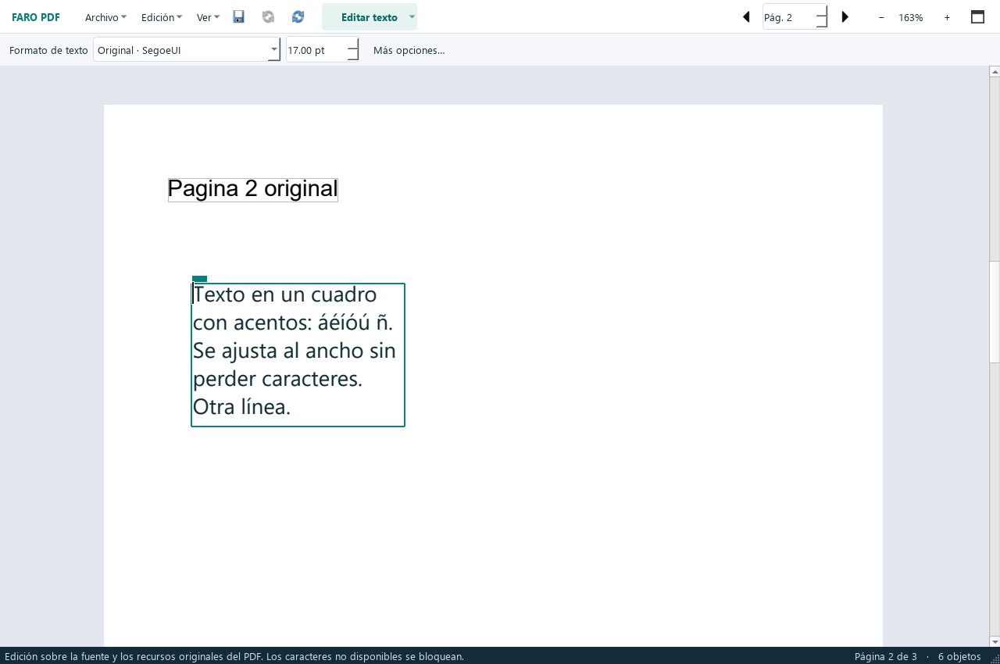

# Faro PDF

**Lee y edita tus PDF en Windows, gratis y en tu equipo.**

Faro PDF nace como una alternativa de código abierto para tareas habituales
que suelen estar reservadas a editores de pago: modificar texto, trabajar con
imágenes y organizar páginas. No requiere una cuenta ni una suscripción.
La interfaz actual está en español.

> Primera versión pública preliminar. El proyecto está en desarrollo:
> trabaja sobre copias y revisa el resultado antes de usarlo.

## Descargar e instalar

Para **Windows 10/11 de 64 bits**:

- [Descargar instalador de Faro PDF 1.5.1](https://github.com/PabloVPMX/faro-pdf/releases/download/v1.5.1/FaroPDF-1.5.1-Instalar.exe)
- [Descargar versión portable](https://github.com/PabloVPMX/faro-pdf/releases/download/v1.5.1/FaroPDF-1.5.1-Portable.zip)
- [Ver todas las versiones y notas](https://github.com/PabloVPMX/faro-pdf/releases)

El instalador incluye Python, Qt y PDFium; no hace falta instalarlos por
separado. Registra Faro PDF en «Abrir con» y crea accesos directos. Puedes
desinstalarlo desde Configuración de Windows. Para usarlo como lector
predeterminado, elige Faro PDF al abrir un archivo PDF con «Abrir con».
Windows conserva tu elección actual hasta que la cambies.

Para la edición portable, extrae **todo el ZIP** y ejecuta `FaroPDF.exe`.
Conserva la carpeta `_internal` junto al ejecutable.

## Actualizaciones

Pulsa **Actualizar** en la barra superior o **Archivo → Actualizaciones**.
La edición instalada busca nuevas versiones cada día mientras se utiliza Faro,
las descarga en segundo plano y las instala al cerrar todas sus ventanas.
Los documentos pasan por el diálogo habitual de guardar cambios antes de cerrar.
**Actualizar ahora** permite instalar y volver a abrir la aplicación.

Las dos opciones automáticas están activadas inicialmente y se pueden desactivar
en ese mismo cuadro. Sin conexión puedes seguir usando el programa. Faro comprueba
el tamaño y SHA-256 del instalador contra los archivos de la publicación oficial.
Esto comprueba la descarga; la firma digital de Windows continúa pendiente.

Para pasar desde **1.1.1 o anteriores**, ejecuta una vez el nuevo instalador sobre
la instalación existente: no hace falta desinstalar ni descargar los otros archivos.
La edición portátil busca versiones, pero se actualiza extrayendo el ZIP nuevo.
El canal incluye las versiones públicas preliminares con número completo.

**Firma digital:** la primera versión pública todavía no está firmada.
Windows puede mostrar advertencias o bloquearla, especialmente con Smart App
Control activo. Publicar en GitHub no elimina ese requisito. No se pide
desactivar el antivirus. Consulta nuestra [Code signing policy](CODE_SIGNING.md).

## Qué puedes hacer

- Leer PDF con desplazamiento vertical continuo, navegar por páginas y ajustar el zoom.
- Buscar texto en todas las páginas, con coincidencias resaltadas, mayúsculas y
  palabras completas; avanzar y retroceder con Enter, F3 y Mayús+F3.
- Imprimir con el diálogo de Windows, seleccionar páginas y revisar la vista previa.
- Reconocer escaneos con OCR local en español e inglés, conservar su imagen y
  obtener texto buscable y seleccionable, sin cuenta ni conexión.
- Seleccionar texto nativo o reconocido y copiarlo con Ctrl+C.
- Seleccionar imágenes y cuadros completos, arrastrarlos individualmente o en
  grupo, cortarlos, copiarlos y pegarlos en otra página o ventana de Faro.
- Seleccionar y trasladar gráficos vectoriales, incluidos contornos de letras,
  conservando sus formas sin buscar ni sustituir una fuente.
- Editar texto nativo directamente en sus recuadros: seleccionar, añadir y
  borrar letras, escribir acentos e insertar saltos de línea.
- Conservar la fuente original cuando sus recursos permiten verificar el
  cambio; elegir otra fuente es una acción explícita.
- Dibujar cuadros de texto sobre la hoja, escribir dentro y ajustar su fuente
  y tamaño en una barra aparte. El texto nuevo se ajusta al ancho del cuadro.
  Los cuadros añadidos usan sus propias fuentes aunque el texto original de esa
  página tenga una codificación que impida editarlo de forma segura.
- Mover los cuadros de texto y volver a editarlos después de guardar.
- Insertar imágenes, moverlas, redimensionarlas desde sus bordes y borrarlas.
- Combinar varios PDF al inicio, al final o en una posición intermedia.
- Mover y borrar páginas, deshacer y rehacer, y guardar una copia.

La vista usa todo el ancho disponible. Las opciones se muestran en menús y
paneles flotantes para dejar espacio al documento.

## Uso rápido

1. Abre un PDF con el menú Archivo, arrastrándolo a la ventana o con «Abrir con».
2. Elige **Editar texto** y haz clic dentro de un recuadro.
3. **Enter** añade una línea; **Ctrl+Enter** o clic fuera aplica; **Esc** cancela.
4. En **Añadir texto**, arrastra un recuadro sobre la hoja y escribe dentro.
   La barra de formato permite elegir la fuente y el tamaño sin abrir otra
   ventana. Un clic también crea un cuadro de tamaño inicial. Usa el tirador
   verde para moverlo; el cuadro crece hacia abajo si hacen falta más líneas.
5. En **Imágenes**, arrastra la imagen o sus tiradores. Las esquinas conservan
   la proporción. El menú Edición permite insertar imágenes y organizar páginas.
6. Guarda con **Archivo → Guardar copia**. **Ctrl+Z** deshace.

La vista continua está activada al abrir el documento. Puedes desactivarla
en **Ver → Desplazamiento vertical continuo** para ver una sola página.
Desplazarte mientras escribes conserva la edición en su página; hacer clic
en otra página aplica el cambio antes de comenzar a trabajar allí.

## Buscar e imprimir

Pulsa **Ctrl+F** o **Archivo → Buscar en el documento**. Escribe el texto y usa
las flechas, **Enter / F3** y **Mayús+Enter / Mayús+F3** para recorrer los resultados.
**Aa** distingue mayúsculas y **Palabra completa** evita coincidencias parciales.
**Esc** cierra la barra. La búsqueda incluye las ediciones aplicadas y vuelve a
calcularse al cambiar el contenido. Los resaltados son solo visuales: no se
guardan ni se imprimen. Para los escaneos, usa **Edición → Reconocer texto (OCR)**.

## Seleccionar objetos, cortar y pegar

Elige **Seleccionar objetos** en el selector de herramientas o en **Edición**.
Un clic selecciona una imagen o un cuadro de texto completo; **Ctrl+clic** añade
o quita elementos. Arrastra un recuadro alrededor de varios objetos para marcarlos
juntos, o usa **Ctrl+A** para seleccionar los objetos de la página actual.

Arrastra la selección para moverla. **Ctrl+C** copia, **Ctrl+X** corta,
**Ctrl+V** pega y **Supr** borra. Estas acciones también están en Edición y en
el menú del clic derecho. **Pegar aquí** sitúa la selección junto al cursor;
Ctrl+V desplaza ligeramente cada copia. Puedes pegar en otra página o ventana de
Faro. **Ctrl+Z** deshace el movimiento, corte o pegado completo en un solo paso.

Los cuadros añadidos conservan su fuente, tamaño, color y líneas al copiarlos;
haz doble clic para volver a editar su texto. Las imágenes conservan sus recursos
PDF y transparencia. También puedes pegar imágenes o texto de otras aplicaciones.
Mientras escribes dentro de un cuadro, los atajos actúan sobre sus letras.
**Seleccionar texto** sigue disponible para copiar palabras, incluido el OCR;
el texto invisible del OCR no se trata como un cuadro editable.

Algunos PDF dibujan las letras como contornos vectoriales. **Seleccionar objetos**
agrupa los trazos próximos para copiarlos, cortarlos y moverlos como gráficos;
un recuadro permite seleccionar otros conjuntos. Los contornos siguen siendo
gráficos y no se editan con un cursor de texto. Para buscar o copiar sus letras
como texto, usa **Reconocer texto (OCR)**. Las imágenes se extraen conservando
sus transformaciones originales, incluso en páginas con varios streams de contenido.

## Reconocer escaneos y copiar texto

Abre **Edición → Reconocer texto (OCR)**, elige la página actual, todo el documento
o un rango como `1-3, 5`, y el idioma. Español e inglés están incluidos. El proceso
se ejecuta localmente en un proceso independiente y permite cancelar; hasta que
termina correctamente no cambia el documento. Las páginas que ya tienen texto
se omiten para evitar duplicados.

Faro conserva las imágenes y añade una capa de texto invisible. Compara el
renderizado antes y después y descarta resultados que alteren su apariencia.
Elige **Seleccionar texto**, arrastra sobre las palabras y pulsa **Ctrl+C**;
**Ctrl+A** selecciona el texto de la página actual. La búsqueda funciona con
**Ctrl+F**. Guarda una copia para conservar el reconocimiento al reabrir el PDF.
**Ctrl+Z** deshace el OCR completo.

Revisa nombres, acentos y cantidades: el reconocimiento puede contener errores.
El OCR no identifica la fuente original ni reconstruye párrafos editables.
Puedes añadir tus propios cuadros de texto sobre el documento con la herramienta
habitual. Esta versión no corrige automáticamente la inclinación de los escaneos
ni reconoce manuscritos de forma fiable.

Pulsa **Ctrl+P** o **Archivo → Imprimir** para elegir la impresora y las páginas.
**Archivo → Vista previa de impresión** permite revisar la salida antes de
enviarla. Se imprime la versión editada actual, ajustada al área imprimible y
conservando las proporciones, con imágenes de hasta 300 ppp. Las páginas de
distinto tamaño se adaptan al papel elegido en el diálogo. La impresión no
cambia el PDF original ni sustituye el guardado de una copia.

## Límites actuales

- El OCR permite buscar y copiar escaneos; no convierte su imagen en texto
  editable ni garantiza exactitud en documentos borrosos, tablas o manuscritos.
- Algunos PDF, fuentes, transparencias y estructuras complejas pueden
  rechazar cambios para evitar alterar el resto de la página.
- No incluye todavía firmas digitales de documentos,
  edición de PDF con contraseña ni recomposición automática de párrafos.
- Los cuadros nuevos ajustan sus líneas al ancho. El texto original conserva
  su disposición; no se recompone automáticamente como un documento de Word.
- **Borrar texto no es una redacción segura.** El guardado incremental puede
  conservar revisiones anteriores dentro del archivo. No lo uses para ocultar
  información confidencial de manera irreversible.
- La firma digital de la aplicación y la firma de documentos PDF son funciones
  diferentes. Ninguna se ofrece como resuelta en esta publicación.

## Privacidad

El procesamiento de los PDF ocurre localmente. Faro PDF no incluye
telemetría, publicidad ni subida automática de documentos. Buscar una fuente
abre Google Fonts en el navegador solo cuando pulsas esa opción; importar un
TTF lee un archivo local y no lo instala en Windows.
Las comprobaciones de actualizaciones conectan con GitHub y descargan sus paquetes;
se pueden desactivar y nunca incluyen el contenido de los PDF.
Consulta [PRIVACY.md](PRIVACY.md).

## Compilar y contribuir

El código de Faro PDF está bajo [licencia MIT](LICENSE). Las bibliotecas
mantienen sus propias licencias, descritas en
[THIRD_PARTY_NOTICES.md](THIRD_PARTY_NOTICES.md).

Consulta [BUILDING.md](BUILDING.md) para ejecutar o compilar el programa y
[CONTRIBUTING.md](CONTRIBUTING.md) para proponer mejoras. La compilación
automatizada utiliza exclusivamente documentos sintéticos de prueba.

Puedes [reportar un problema o proponer una mejora](https://github.com/PabloVPMX/faro-pdf/issues).
No adjuntes estados de cuenta, identificaciones, cotizaciones ni otros datos
personales: reproduce el caso con un PDF de ejemplo sin información sensible.

## Code signing policy

La política y el estado de la firma están en [CODE_SIGNING.md](CODE_SIGNING.md).
La firma de futuras versiones está pendiente de obtener un proveedor y de su
evaluación; no se afirma una aprobación de SignPath ni de Microsoft.
